<!--
marp: true
theme: default
paginate: true
size: 16:9
-->

# Отчёт по лабораторной работе № 5

## Эмуляция и измерение потерь пакетов в глобальных сетях

**Воспроизводимый эксперимент NETEM**

Выполнил: студент

---

# Цель и задания

Я исследовал влияние сетевых искажений на передачу пакетов в тестовой сети Mininet с использованием механизма **NETEM**.

В ходе работы я проверил:

- потерю пакетов;
- корреляцию потерь;
- повреждение пакетов;
- переупорядочивание пакетов;
- дублирование пакетов.

Для проверки использовал `ping` и `iPerf3`.

---

# Запуск Mininet и создание топологии

Я запустил Mininet и создал простую топологию из двух хостов и коммутатора.

- **h1** — `10.0.0.1`
- **h2** — `10.0.0.2`

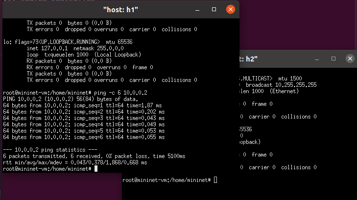

---

# Проверка исходной связности

Перед настройкой сетевых искажений я проверил доступность хоста `h2` с хоста `h1`.

Это позволило убедиться, что исходная сеть работает корректно и результаты следующих экспериментов связаны именно с настройками NETEM.

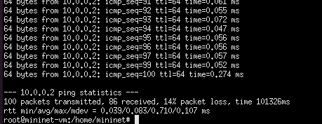

---

# Потеря 10% пакетов

Я настроил потерю **10%** пакетов на исходящем интерфейсе `h1`.

Затем отправил 100 ICMP-пакетов и проанализировал статистику `ping`.

При такой настройке ожидаемая доля потерь составляет около 10%, однако фактическое значение может отличаться из-за случайного характера потерь.

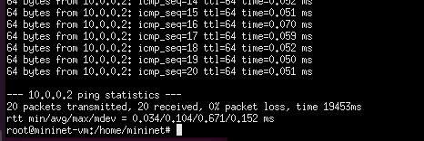

---

# Потери в двух направлениях

Я добавил потерю **10%** пакетов также на интерфейсе `h2` и повторно проверил связь между хостами.

Потери могли возникать как при передаче запроса, так и при передаче ответа. При независимой вероятности 10% в каждом направлении вероятность успешного обмена составляет примерно 81%.

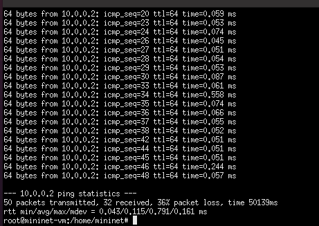

---

# Корреляция потерь

Я настроил вероятность потери **50%** с корреляцией **50%**.

После этого отправил 50 ICMP-пакетов и проанализировал пропуски в последовательности `icmp_seq`.

Корреляция влияет на группирование потерь: пакеты могут теряться сериями, а не равномерно по одному.

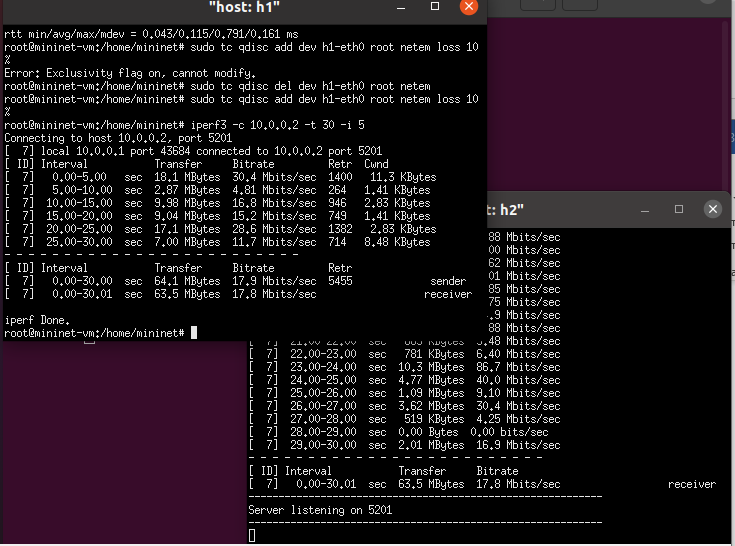

---

# Повреждение пакетов и TCP

Я настроил повреждение пакетов на интерфейсе `h1`.

Для проверки TCP-трафика запустил сервер и клиент `iPerf3`, после чего изучил показатель повторных передач **Retr**.

Повреждение пакетов может приводить к обнаружению ошибок и повторной передаче данных транспортным протоколом.

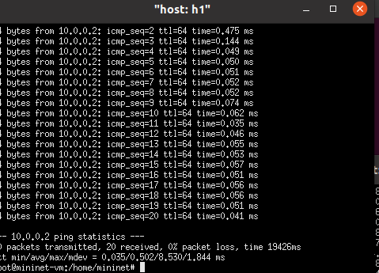

---

# Переупорядочивание пакетов

Я задал задержку **10 мс** и переупорядочивание **25%** с корреляцией **50%**.

По ответам `ping` сравнил наблюдаемые значения времени доставки и проверил влияние изменения порядка поступления пакетов.

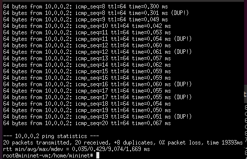

---

# Дублирование пакетов

Я настроил дублирование **50%** пакетов.

В выводе `ping` проверял появление повторных ответов, помеченных как `DUP!`, и оценивал их количество.

Фактическое число дубликатов зависит от работы механизма эмуляции и результатов конкретного запуска.

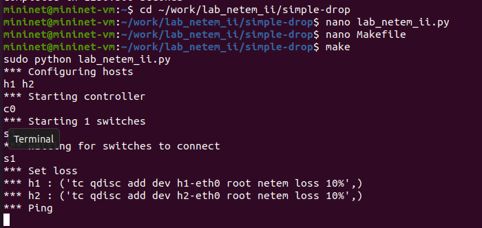

---

# Воспроизводимый эксперимент NETEM

Я подготовил Python-скрипт на основе Mininet API.

Скрипт автоматически:

1. создавал тестовую топологию;
2. применял выбранное правило NETEM;
3. выполнял проверку соединения;
4. сохранял результаты эксперимента.

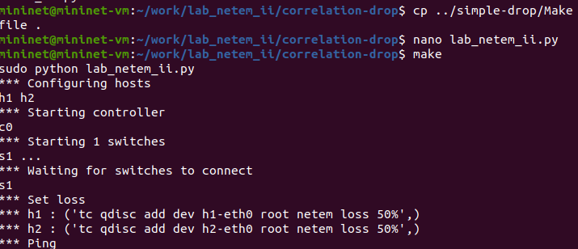

---

# Запуск экспериментов через Makefile

Я подготовил `Makefile`, который упрощает запуск различных режимов эксперимента и очистку файлов с результатами.

Это позволяет повторять измерения без ручного ввода длинных команд.

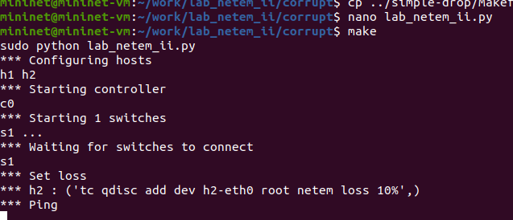

---

# Сбор и сохранение результатов

Для режимов на основе `ping` скрипт сохранял вывод в `ping.txt` и выводил:

- количество отправленных пакетов;
- количество полученных пакетов;
- процент потерь.

Для режима `corrupt` сохранялся JSON-отчёт `iPerf3`.

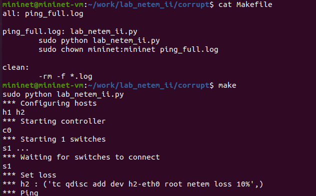

---

# Сводная таблица результатов

| Режим | Настройка / способ оценки |
|---|---|
| Исходная сеть | Ожидаемо 0% потерь |
| Потери в одном направлении | 10% — ориентировочно 10 из 100 пакетов |
| Потери в двух направлениях | Ориентировочно 19 из 100 неуспешных обменов |
| Корреляция потерь | Фактическая доля зависит от серии потерь |
| Повреждение | Число повторных передач `Retr` по iPerf3 |
| Переупорядочивание | Наблюдаемые задержки и порядок ответов `ping` |
| Дублирование | Повторные ответы `DUP!` в выводе `ping` |

*Численные оценки для случайных потерь являются ориентировочными. В отчёте следует использовать фактические значения, полученные при запуске эксперимента.*

---

# Вывод

В ходе лабораторной работы я создал тестовую сеть Mininet из двух хостов и коммутатора.

С помощью NETEM я исследовал потерю пакетов, корреляцию потерь, повреждение, переупорядочивание и дублирование пакетов. Проверку выполнял средствами `ping` и `iPerf3`.

Также я подготовил воспроизводимый Python-эксперимент на основе Mininet API и `Makefile` для его запуска и сохранения результатов.

**Цель лабораторной работы достигнута.**
