МИНИСТЕРСТВО НАУКИ И ВЫСШЕГО ОБРАЗОВАНИЯ РФ

______________________________________________

ОТЧЁТ

по лабораторной работе № 5

«Эмуляция и измерение потерь пакетов в глобальных сетях»

Выполнил(а): студент(ка) группы __________

ФИО: ____________________________________

Проверил(а): ______________________________

__________________ 2026

## 1. Цель работы

Целью моей работы было получение навыков проведения интерактивных экспериментов в среде Mininet и исследование потери, дублирования, переупорядочивания и повреждения пакетов при передаче данных.

## 2. Формулировка задания

Я создал простейшую топологию из двух хостов и коммутатора с адресным пространством Mininet 10.0.0.0/8.

Я провёл интерактивные эксперименты по исследованию потери, дублирования, переупорядочивания и повреждения пакетов.

Я реализовал воспроизводимый эксперимент с правилом отбрасывания пакетов и получил сводную информацию о потерях.

Я самостоятельно реализовал воспроизводимые эксперименты для потери, переупорядочивания и повреждения пакетов и получил сводную информацию о результатах.

## 3. Краткие теоретические сведения

Потеря пакета — ситуация, при которой пакет, проходящий через сеть, не достигает пункта назначения. Одной из причин является перегрузка сетевого оборудования и ограниченный объём буферной памяти. Потери могут снижать производительность TCP: при обнаружении перегрузки TCP уменьшает окно перегрузки.

Переупорядочивание пакетов возникает, когда получатель принимает пакеты не в том порядке, в котором они были отправлены. Повреждение пакета означает изменение передаваемых битов; некорректный пакет может быть отброшен получателем. Дублирование означает получение нескольких копий одного пакета.

Для моделирования сетевых эффектов я использовал NETEM — механизм Linux Traffic Control, настраиваемый средствами tc qdisc.

## 4. Ход выполнения работы

## 4.1. Запуск Mininet и создание топологии

После запуска виртуальной машины Mininet я подключился к ней из основной операционной системы, указав фактический IP-адрес виртуальной машины.

При необходимости я настроил доступ к X-соединению по инструкции методички, после чего создал сетевую топологию.

После запуска открылись отдельные терминалы хостов h1 и h2, коммутатора и контроллера. Для дальнейшей работы я использовал терминалы h1 и h2.

В созданной топологии хосты получили адреса h1 — 10.0.0.1 и h2 — 10.0.0.2. Для экспериментов я использовал интерфейсы h1-eth0 и h2-eth0 и проверил исходную связность командой ping.

По итоговой строке ping я определил количество отправленных и полученных пакетов, процент потерь, а также значения RTT: минимальное, среднее и максимальное время и стандартное отклонение, если оно отображалось.

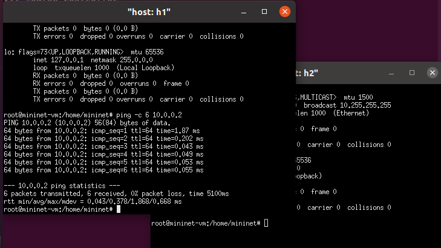

*Рисунок 1 — Созданная топология Mininet и проверка исходной связности между хостами.*

## 4.2. Интерактивные эксперименты

## 4.2.1. Потеря 10% пакетов в одном направлении

Сначала я настроил потерю 10% пакетов на исходящем интерфейсе хоста h1.

Затем я проверил передачу 100 ICMP-пакетов.

Я отметил пропущенные значения icmp_seq и итоговый процент потерь. После этого настроил потерю 10% пакетов также на интерфейсе h2.

После изменения настройки я повторно проверил связь из h1.

Я сравнил отсутствующие значения icmp_seq и итоговый процент потерь. При потерях в двух направлениях могли теряться как echo-request, так и echo-reply.

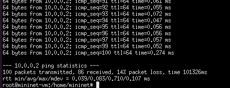

*Рисунок 2 — Результат проверки передачи пакетов после настройки потерь.*

Затем я удалил правила NETEM и проверил восстановление связи между хостами.

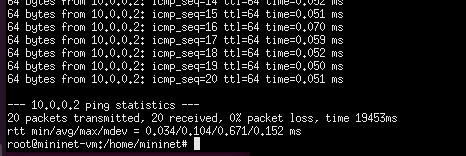

*Рисунок 3 — Проверка связи после изменения параметров потерь.*

## 4.2.2. Корреляция потерь

В следующем эксперименте я установил на интерфейсе h1 вероятность потери 50% и корреляцию 50%.

По результатам я определил отсутствующие номера icmp_seq и процент потерь. Корреляция задаёт зависимость вероятности следующего события от предыдущего, поэтому потери могли группироваться, а фактическая доля могла отличаться от 50%.

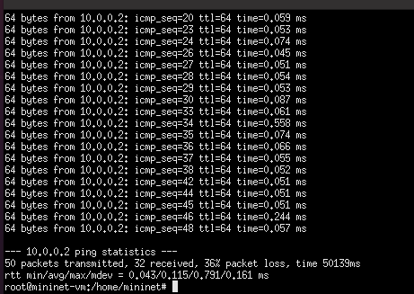

*Рисунок 4 — Результат эксперимента с корреляцией потерь.*

## 4.2.3. Повреждение пакетов и повторные передачи TCP

Перед экспериментом я убедился, что предыдущие правила удалены, и настроил повреждение 0,01% на интерфейсе h1.

На хосте h2 я запустил сервер iPerf3.

На хосте h1 я запустил клиент iPerf3.

По выводу клиента я проверил значения Retr на временных интервалах и общее количество повторных передач TCP. После завершения теста я остановил сервер и удалил правило NETEM.

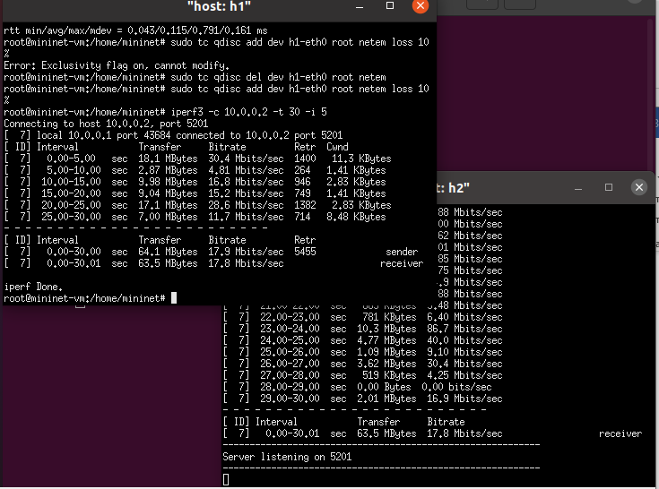

*Рисунок 5 — Запуск iPerf3 для исследования повреждения пакетов и повторных передач TCP.*

## 4.2.4. Переупорядочивание пакетов

Для исследования переупорядочивания я настроил на интерфейсе h1 задержку 10 мс и вероятность переупорядочивания 25% с корреляцией 50%.

В выводе ping я сравнил значения time для ответов. Часть пакетов могла приходить практически без заданной задержки, остальные — с задержкой около 10 мс. В анализе я учитывал только фактически наблюдавшиеся значения, поскольку ping не всегда наглядно показывает порядок доставки.

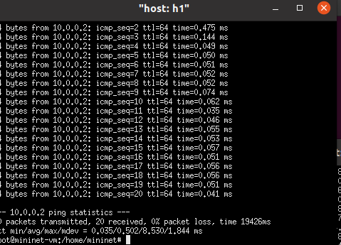

*Рисунок 6 — Результат эксперимента с задержкой и переупорядочиванием пакетов.*

## 4.2.5. Дублирование пакетов

В эксперименте с дублированием я настроил копирование 50% пакетов и проверил результат с помощью ping.

Дублированные ответы в выводе ping обозначались как DUP!. Я подсчитал такие строки и сравнил наблюдаемую долю с заданными 50%.

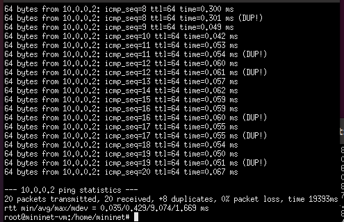

*Рисунок 7 — Результат эксперимента с дублированием пакетов; ответы отмечены DUP!.*

## 4.3. Воспроизводимый эксперимент с потерями (Mininet API)

Для воспроизводимого эксперимента я создал каталог и Python-скрипт. Скрипт автоматически создавал топологию, применял NETEM, выполнял ping, сохранял полный вывод и выводил статистику.

Я подготовил файл lab_netem_ii.py с реализацией режимов эксперимента.

Затем я запустил воспроизводимые режимы эксперимента.

Скрипт применял правило к интерфейсу h1-eth0. В режимах на основе ping он сохранял вывод в ping.txt и показывал количество отправленных и полученных пакетов, а также процент потерь. В режиме corrupt скрипт сохранял JSON-вывод iPerf3 в iperf3.json и выводил число повторных передач TCP, если это значение присутствовало в ответе.

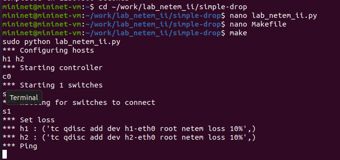

*Рисунок 8 — Выполнение воспроизводимого эксперимента NETEM в режиме simple-drop.*

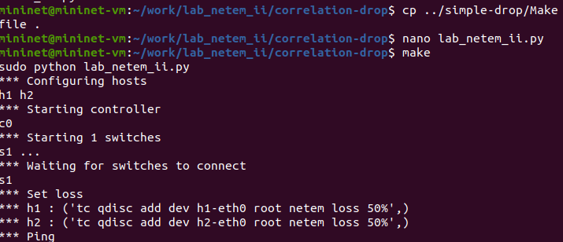

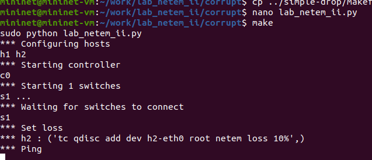

*Рисунок 9 — Запуск воспроизводимого эксперимента с коррелированными потерями.*

## 4.4. Makefile

Для упрощения запуска экспериментов я подготовил Makefile в каталоге проекта.

С помощью Makefile я проверил запуск разных режимов и очистку созданных файлов.

## 5. Сводная таблица результатов

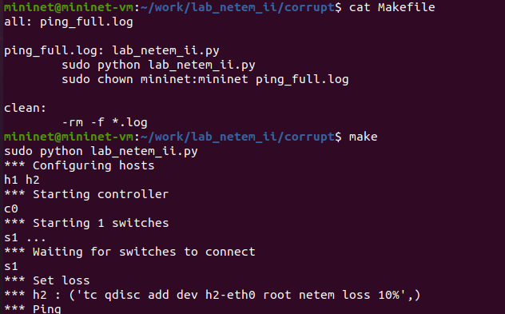

*Рисунок 10 — Настройка и выполнение воспроизводимого эксперимента в Mininet.*

| Эксперимент | Настройка NETEM | Пакетов отправлено | Потери / эффект | Наблюдение |
| --- | --- | --- | --- | --- |
| Исходное состояние | без правила | 6 | ___ % | RTT min/avg/max/mdev: ______ |
| Потери | loss 10% | 100 | ___ % | icmp_seq: ______ |
| Потери в двух направлениях | loss 10% на h1 и h2 | 100 | ___ % | icmp_seq: ______ |
| Корреляция | loss 50% 50% | 50 | ___ % | icmp_seq: ______ |
| Повреждение | corrupt 0.01% | iperf3 | Retr: ______ | повторные передачи: ______ |
| Переупорядочивание | delay 10ms reorder 25% 50% | 20 | ___ % | наблюдаемые времена: ______ |
| Дублирование | duplicate 50% | 20 | DUP!: ______ | доля дубликатов: ______ |

## 6. Анализ результатов

В ходе работы я исследовал влияние параметров NETEM на передачу пакетов. Для каждого режима я сопоставил заданную настройку с показателями терминального вывода. При потере пакетов я сравнивал число отправленных и полученных пакетов и определял долю потерь. При повреждении анализировал повторные передачи TCP по данным iPerf3. При переупорядочивании рассматривал наблюдаемые задержки, а при дублировании — ответы, отмеченные ping как DUP!.

Фактические числовые значения я занёс в таблицу 5 по результатам выполненных экспериментов. На результаты влияли версия Mininet, ядро Linux, параметры виртуальной машины и случайный характер NETEM.

## 7. Вывод

В ходе лабораторной работы я создал тестовую сеть Mininet из двух хостов и коммутатора. С помощью NETEM я исследовал потерю, корреляцию потерь, повреждение, переупорядочивание и дублирование пакетов. Проверку выполнял с помощью ping и iPerf3. Также я подготовил воспроизводимый Python-эксперимент на основе Mininet API и Makefile для его запуска. Результаты и наблюдения представлены в таблице 5 и подтверждены снимками экрана.

Перед сдачей я проверил, что в отчёте указаны фактические измерения, приложены скриншоты и заполнен титульный лист.

Приложение А. Команды для быстрой проверки и снятия скриншотов

Перед каждым новым интерактивным экспериментом я удалял предыдущее правило NETEM, чтобы настройки не конфликтовали.

Для сохранения вывода в файл одновременно с отображением на экране я использовал утилиту tee.

На скриншотах я сохранил команды, ход их выполнения и итоговую статистику. Для каждого опыта также показал команду tc, задающую соответствующее правило.
